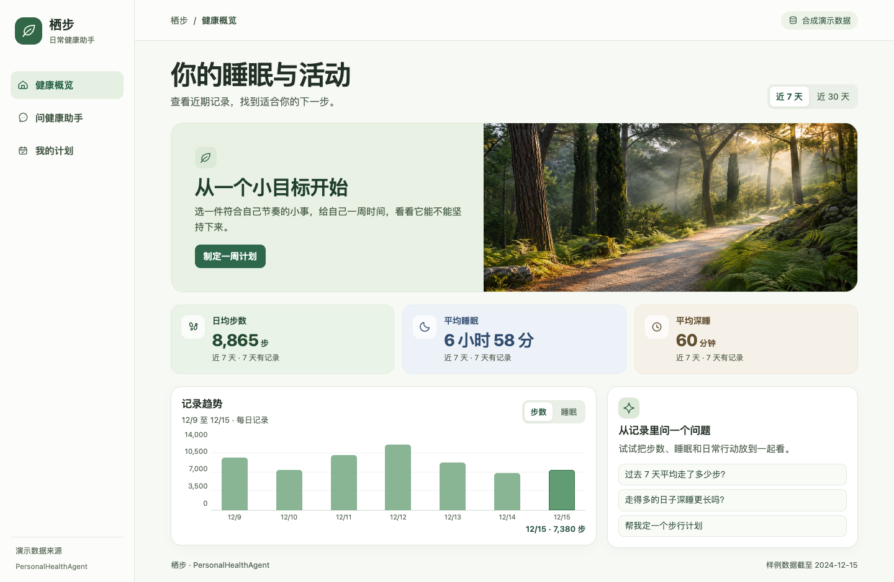
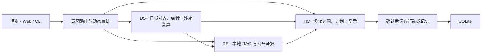

# 栖步 · Personal Health Agent

一个用于个人睡眠与运动数据的多 Agent 应用。它把记录查询、证据检索和健康教练拆成三个可独立运行的 Agent，由编排器按任务组合。上手使用 365 天合成记录，无需 API 密钥。

[快速开始](#快速开始) · [架构](#架构) · [评测](#评测) · [开发指南](docs/guide.md) · [许可证](LICENSE)



## 快速开始

在仓库根目录运行。需要 Python 3.11 或更新版本。

```sh
python3 -m venv .venv
source .venv/bin/activate
python -m pip install ".[web]"
python -m health_agent.web --qibu-home --qibu-data-dir .qibu-data
```

打开 [栖步用户端](http://127.0.0.1:8765/qibu/#chat)，依次问「昨晚睡了多久」「那深睡呢」。查询以样例日期 2024-12-15 为基准，追问会沿用上一轮的日期。也可以说「今天午休十分钟」，确认后在「我的计划」查看。刷新可恢复同一浏览器的会话。

开发工作台展示 Agent 分派、工具调用和评测轨迹。安装 Node.js 22 后执行 `npm --prefix web ci` 和 `npm --prefix web run build`，然后去掉 `--qibu-home` 重启服务并打开 [开发工作台](http://127.0.0.1:8765/)。工作台默认提供联合分析和 Skill 评测回放。

配置语言模型时，使用 `--model` 连接本机 Ollama，或复制 [.env.example](.env.example) 并用 `--deepseek-env .env` 连接并行智算云。此时用户问题和相关对话状态会发往所选模型端点。在线取证通过 `--online-evidence` 开启，外部来源使用当前进程的环境变量。生成代码的实时沙箱执行依赖 macOS 的 `sandbox-exec`。

## 架构



- **工具调用** 使用同一套 Python SDK 校验参数并调用数据工具，也通过 stdio MCP 提供只读接口。
- **渐进式披露** 编排时读取 Skill 名称和描述，执行时加载正文，具体分支按需加载参考材料。
- **确认与持久化** 当天行动和长期限制分别处理。用户确认后才保存长期限制，后续会话可复用支持的限制。
- **离线自进化** 从失败轨迹生成 DE 检索策略候选，通过来源校验和逐例回归后保留版本，供对比和回滚。

## 评测

| 实验 | 结果 | 复现资料 |
| --- | --- | --- |
| Qwen3-4B-Instruct-2507 BF16 LoRA | 新场景合成分类由 125/140 提升至 135/140，有效任务派发全对由 22/24 提升至 23/24 | [训练与逐例评测](experiments/intent_experiment/README.md) |
| DE Skill 离线优化 | 同一固定检索回放下，合成留出集由 10/15 提升至 15/15 | [评测代码与复现方法](docs/guide.md#de-skill-离线自进化) |
| 用户端浏览器验收 | 6 个场景覆盖追问、改口、确认、会话恢复、缺数据和故障重试 | [验收脚本](scripts/qibu_acceptance.mjs) · [运行步骤](docs/qibu-pilot.md) |

```sh
python -m pip install ".[web,mcp,test]"
python -m unittest discover -s tests
node --test user-web/tests/health.test.mjs
python -m health_agent eval-de --split test
python -m health_agent --skill-root examples/evolved-skills \
  --skill-version DE=de-20261123-084104-9d44e9-g1-c1 eval-de --split test
```

## 数据与许可

项目代码采用 [Apache-2.0](LICENSE)。演示使用公开合成数据，来源和第三方许可见 [NOTICE](NOTICE)。项目供健康记录分析与 Agent 开发演示使用。
