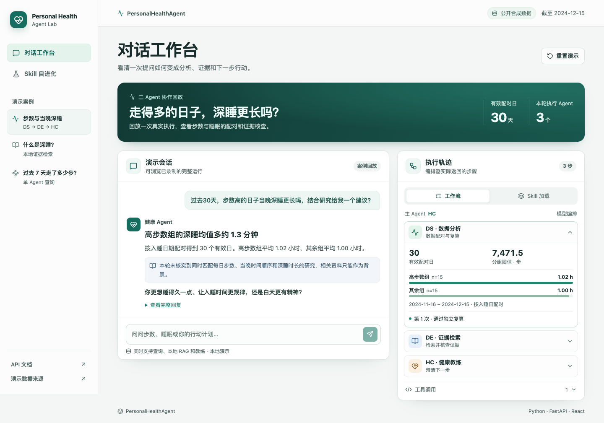

# Personal Health Agent

本地运行的睡眠和运动数据助手。首版支持导入每日睡眠时长和步数、查询趋势、对比时间窗口、设定每日目标，以及用新数据复盘。运行时包含一个编排器和三个职责独立的 Agent。

## Web 演示

面向普通用户的「栖步」界面在 [user-web](../user-web/README.md)，提供合成健康记录、问答和七日打卡。

从项目根目录运行 FastAPI 后，打开 [栖步 Agent 页面](http://127.0.0.1:8765/qibu/#chat)。这个入口调用服务器上的意图路由、统计和证据工具。行动先生成提议，经确认后写入 SQLite。可以用 `--qibu-data-dir` 指定持久化目录，也可以用 `--qibu-home` 让网站根地址直接打开栖步。

```sh
python -m health_agent.web --deepseek-env "$MODEL_ENV" \
  --qibu-data-dir ".qibu-data"
```

配置远程模型时，问答内容和本轮需要的结构化状态交给该模型理解。睡眠和步数原始记录由本地统计工具读取。此入口使用合成样例，供本地联调。静态站点继续支持浏览器内体验。

同一浏览器可恢复和切换会话。设置 `--qibu-data-dir` 后，聊天记录、查询上下文和已确认的记忆在服务重启后仍可恢复。「今天午休十分钟」只生成当天行动提议。「我工作日午休只有十分钟」会先请求确认，随后可在新会话安排工作日午休时使用。可以在「我的记忆」移除这项限制。

真实模型的浏览器回归脚本和人工试用任务见[栖步验收与内测](qibu-pilot.md)。

用同一套 Python Agent 核心运行 FastAPI，并通过 React 工作台查看对话、工具调用、执行轨迹和 Skill 的渐进式披露。自进化页可比较 DE 的初始策略、入选策略和淘汰候选，展开同一个场景的查询与评测结果。



需要 Python 3.11+ 和 Node.js 22+。在项目根目录执行以下命令，然后打开 [本地工作台](http://127.0.0.1:8765)。

```sh
python3 -m venv .venv
source .venv/bin/activate
python -m pip install ".[web]"
npm --prefix web ci
npm --prefix web run build
python -m health_agent.web
```

默认加载 365 天公开合成记录，无需模型密钥。步数查询、本地证据检索和教练对话可以实时运行。三 Agent 联合分析及自进化页使用已保存的回放，并在界面中标明。网页会话存入进程管理的临时 SQLite 文件，服务退出时清理。

在支持沙箱的 macOS 上，配置模型后可实时执行联合分析。`--online-evidence` 开启外部检索。可以接入已有 DeepSeek 网关配置，也可以通过 `--model` 选择已安装的 Ollama 模型。

```sh
python -m health_agent.web --deepseek-env "$MODEL_ENV" --online-evidence
```

在另一个终端运行 `npm --prefix web run dev` 可以使用 Vite 开发服务器。FastAPI 默认监听 `127.0.0.1:8765`，同一地址下的 `/docs` 显示 API。JSON 请求使用 `POST /api/chat`，工作台使用 `POST /api/chat/stream` 接收编排、Agent 开始与完成事件及最终结果。

演示数据的出处和许可见 [Google PHA 样例说明](../examples/google_pha/README.md)。浏览器回放位于 `health_agent/web_samples/`。运行 `python -m scripts.export_web_samples <进化运行目录>` 可从已有实验更新评测回放。另有 [自进化页截图](demo-evolution.png) 可快速浏览。

## 运行

需要 Python 3.11 或更新版本。进入项目目录后即可运行演示，演示使用虚构数据和内存数据库。

```sh
python3 -m health_agent --trace demo
python3 -m unittest discover -s tests -v
```

运行 Nature PHA 作者仓库的 365 天官方合成样例，并查看主辅 Agent、子问题和执行记录。

```sh
python3 -m health_agent --trace pha-demo
```

用 已有的并行智算云网关凭证启用 DeepSeek V4.1 Flash 编排。将 `MODEL_ENV` 设为本项目的本地 `.env` 路径，运行时读取该文件。

```sh
python3 -m health_agent --deepseek-env "$MODEL_ENV" --trace pha-demo
```

DeepSeek 接收当前消息、最近对话和已确认的任务，用于选择工作流和改写子问题。使用真实个人数据测试时，最近对话可能包含已经回复给用户的数据摘要。`pha-demo` 全程使用公开合成数据。

也可以使用本机 Ollama 执行动态工作流，并启用语义识别、统计解释和教练建议。

```sh
python3 -m health_agent --model qwen2.5:1.5b --trace pha-demo
```

默认路径可离线运行。Ollama 调用本机 `127.0.0.1:11434` 并传入 JSON Schema。DeepSeek 使用 JSON 模式，生成的分派和改写由本地编排器校验。模型不可用或工作流无法通过校验时使用本地规则。 [Ollama Chat API](https://docs.ollama.com/api/chat)

## 独立 Skill 与渐进式披露

DS、DE、HC 各有版本化的 `SKILL.md`，可以独立调用，也可以由编排器传递结构化结果。DS 把已核验的统计交给 DE 和 HC，DE 传递来源、范围和局限，HC 根据现有信息决定追问、提议行动或复盘。

1. 发现阶段读取每个已选版本的名称和描述，动态编排模型收到包含角色和版本的目录。
2. 角色实际执行时加载该角色的正文，每个角色在一轮对话中只加载一次。
3. 具体分支按需读材料。DS 重试才读代码修复指南，DE 有匹配资料并用模型提取时才读引文指南，HC 已知阻碍并用模型选择行动时才读调整指南。`--trace` 显示这些阶段和文件名。

```sh
python3 -m health_agent skills-list
python3 -m health_agent --skills --trace demo
python3 -m health_agent --trace skill-run HC "我想多走点" --metric steps
python3 -m health_agent --trace skill-run DE "什么是总睡眠时长"
python3 -m health_agent --deepseek-env "$MODEL_ENV" --skills --ds-sandbox \
  --de-evidence --coach-loop --tool-calls --trace pha-demo
```

`skill-run DS` 接受 SDK 的只读分析工具和 JSON 参数。`--skill-version ROLE=VERSION` 可分别固定三个角色，`--skill-root` 指定其他版本的目录，未指定的角色使用内置 `v1`。 [Agent Skills 规范](https://agentskills.io/specification)

## DE Skill 离线自进化

用 12 个合成检索场景的 60 条提问做回放，同一场景的 5 条表达留在同一切分。开发集、验证集和留出集分别是 30、15、15 条。模型根据开发集的失败轨迹和既有经验提出候选，程序生成独立版本，使用相同返回资料复测。通过开发集增益、验证集逐例回归和来源校验后，最后在留出集复核。通过才暂存版本并把经验写入 `experience/`，后续运行会读取这些经验。命令用已有模型提出候选，评测使用固定的检索服务回放。

当前可变更的是 DE 联合证据检索的两轮查询策略和对应 Skill 说明。两轮预算、结果匹配、逐字引文校验、工具权限和评测数据由程序控制。评分覆盖证据匹配、引用和因果边界。回放结果用于验证策略行为，真实检索的成效需另行测量。流程借鉴了 Harness² 的轨迹反馈和经验复用。 [Harness²](https://arxiv.org/html/2610.14224v1#S2)

```sh
python3 -m health_agent eval-de --split dev
python3 -m health_agent --deepseek-env "$MODEL_ENV" evolve-de --output .skill-evolution
python3 -m health_agent --skill-root .skill-evolution --skill-version "DE=$DE_VERSION" eval-de --split test
python3 -m health_agent --skill-root .skill-evolution --skill-version "DE=$DE_VERSION" \
  --trace skill-run DE "查步数和当晚的深睡时长" --joint
```

将 `DE_VERSION` 设为报告中的 `released_version`。在协作命令中使用相同的版本参数即可启用，切回 `DE=v1` 可回滚。每次进化会保留报告、候选和逐例回放。需要做经验消融时，固定相同父版本、模型和候选预算，并用 `--no-experience` 运行对照。

## 导入数据并对话

本地 CSV 使用 `date,sleep_hours,steps` 三列，每个日期一行。日期用 `YYYY-MM-DD`，睡眠时长用小时，步数用非负整数。也可以直接导入官方 PHA 格式的 `summary.csv`，程序会识别 `datetime,sleep_minutes,steps` 并转换单位。空字段表示该指标缺失。重新导入同一天可以更新其中一个指标，另一个指标留空时保留原值。项目按北京时间解析相对日期。

```sh
python3 -m health_agent import examples/week_1.csv
python3 -m health_agent --trace chat --as-of 2026-11-15 '根据本周睡眠记录，给我制定一个改善计划'
python3 -m health_agent chat --as-of 2026-11-15 '把我的睡眠目标设为每天 8 小时'
python3 -m health_agent import examples/week_2.csv
python3 -m health_agent --trace chat --as-of 2026-11-22 '根据本周记录复盘我的睡眠目标'
```

`chat` 省略问题时进入多轮对话。`--session` 用于选择对话，目标保存在同一份数据库里。`--db` 可指定不同的 SQLite 文件。默认数据库是项目目录的 `health.sqlite3`，属于本地单用户存储。

## DS 沙箱联合分析

启用后可以问「过去 30 天，步数高的日子当晚的深睡时长更长吗？」。DS 先生成分析计划，再生成 Python 并在本机沙箱进程中执行。运行错误和独立复算发现的统计差异会反馈给模型修正。执行结果通过复算后，模型还可以复核日期对齐和分组规则。代码生成最多尝试五次。`--trace` 的 `sandbox_analyses` 显示分析计划、每次代码与反馈、最终核实结果。 [论文补充材料 C.2](https://static-content.springer.com/esm/art%3A10.1038%2Fs41586-026-11161-8/MediaObjects/41586_2026_11161_MOESM1_ESM.pdf#page=22) · [作者开源实现](https://github.com/Google-Health/consumer-health-research/blob/3e9d1e4877a54cf81ce8ef34085006952dd19601/personal_health_agent/pha/agents/data_science_agent.py#L466)

使用官方合成数据运行整条链路。`MODEL_ENV` 指向上文配置的网关凭证文件。`--ds-sandbox` 也可使用 `--model` 指定的本机 Ollama 模型。

```sh
python3 -m health_agent --deepseek-env "$MODEL_ENV" --ds-sandbox --trace pha-demo
```

当前支持一个日期窗口，按有效配对日的个人步数中位数或已登记的步数目标分组，比对总睡眠或深睡时长的均值。默认按入睡日与步数日期配对。问题明确指定「按记录日」时，会按 CSV 记录日配对。可选的 `bed_time` 和 `deep_sleep_minutes` 随日表一同导入，已导入的旧数据需要重新导入原 CSV 才能补齐。普通单项统计仍走原有计算路径。

执行器目前依赖 macOS 的 `sandbox-exec`，对生成代码限制 Python 语法、输入量和执行时间。每次最多传入 256 行。启用外部证据后，联合统计会传给 DE，用户要求建议时还会传给 HC。原始日记录只交给本机执行进程。使用远程模型时，分析问题、表结构、计划、执行反馈和汇总统计会进入模型请求。

## DE 外部证据检索

启用 `--de-evidence` 后，DE 按「推理 → 调查 → 核查」最多进行两轮检索。第一轮优先选择贴近问题的指标和时间顺序。证据不足时换查询或来源。程序只展示检索实际返回的出处和可核对的摘录，并标出匹配范围。联合分析中，个人记录与外部证据分开呈现。用户要求建议时，HC 收到个人观察、出处和局限。普通统计解释仍可用内置说明。 [Nature Methods 与 Fig. 3](https://www.nature.com/articles/s41586-026-11161-8) · [开源 DE 工具表](https://github.com/Google-Health/consumer-health-research/blob/3e9d1e4877a54cf81ce8ef34085006952dd19601/personal_health_agent/pha/agents/domain_expert_agent.py#L1233)

| 数据源 | 本项目调用方式 |
| --- | --- |
| PubMed | NCBI E-utilities 的 ESearch 查 PMID，再用 EFetch 读题目、摘要和发表类型。可选设 `NCBI_EMAIL` 和 `NCBI_API_KEY`。 |
| 网页 | 配置 `TAVILY_API_KEY` 后用 Tavily 查公共卫生机构网页。无密钥或请求失败时使用 MedlinePlus 公开健康主题检索。 |
| Data Commons | 配置 `DATA_COMMONS_API_KEY` 后直接调用 REST v2 `/observation`，保留地区、统计年份、方法和原始出处。目前支持美国、加利福尼亚州和圣克拉拉县的短睡眠或身体活动不足比例。 |

DE 的检索工具直接调用上述 API。DE 发给公开检索与证据核查的请求只包含限定的问题范围或已返回的公开来源。配置 LLM 时，DE 可用它在候选查询中选择，并从公开来源提取摘录。项目的只读 MCP 服务用于对外提供本地工具。

```sh
python3 -m health_agent --de-evidence --trace chat '什么是健康的睡眠时长？'
python3 -m health_agent --deepseek-env "$MODEL_ENV" --ds-sandbox --de-evidence --trace pha-demo
```

群体数据示例为「美国圣克拉拉县成年人睡眠少于 7 小时的比例是多少？」。trace 的 `evidence_runs` 显示每轮的来源、查询、返回状态、匹配范围和局限。证据来自研究摘要、公开网页摘录和结构化人口统计。论文中的诊断推理、医疗记录与临床参考区间、全文系统综述和原始研究评测超出当前实现范围。 [NCBI E-utilities](https://www.ncbi.nlm.nih.gov/books/NBK25497/) · [MedlinePlus](https://medlineplus.gov/about/developers/webservices/) · [Data Commons API](https://docs.datacommons.org/api/rest/v2/observation.html)

### 本地证据知识库 RAG

论文正文和开源 DE 工具表描述的是网页搜索、文献 API 和群体统计 API 的在线取证。本项目还可以给 DE 配置一份本地 SQLite 知识库，用于检索可重复利用的公开资料和口径说明。 [Nature Fig. 3 与 Methods](https://www.nature.com/articles/s41586-026-11161-8) · [DE 工具表](https://github.com/Google-Health/consumer-health-research/blob/3e9d1e4877a54cf81ce8ef34085006952dd19601/personal_health_agent/pha/agents/domain_expert_agent.py#L1233)

```sh
python3 -m health_agent --evidence-kb evidence.sqlite3 kb-import examples/evidence_kb.jsonl
python3 -m health_agent --evidence-kb evidence.sqlite3 --trace chat '什么是深睡？'
```

JSONL 每行提供 `title`、`url` 和 `text`，`id` 可选，默认为来源 URL。相同来源可用同一个 ID 更新，内容相同的重复导入会跳过。样例是基于公开出处整理的说明卡片。实际导入按段落或句子边界分片，使用带重叠的片段建立 FTS5 BM25 索引。中文采用字符二元组，英文采用单词。

如果本机 Ollama 有 embedding 模型，导入时可附加 `--embed-model`，检索会融合 BM25 和向量余弦相似度的排序。向量服务不可用时使用 BM25。示例用独立数据库，已有索引更新时沿用该库的模型。向量请求使用本机 Ollama，支持通过 `OLLAMA_HOST` 选择回环地址。 [Ollama Embeddings API](https://docs.ollama.com/api/embed)

```sh
ollama pull all-minilm
python3 -m health_agent --evidence-kb evidence-hybrid.sqlite3 \
  kb-import examples/evidence_kb.jsonl --embed-model all-minilm
```

本地命中可用于概念解释。查询无命中、明确需要近期文献或涉及个人联合分析时，DE 继续调用在线来源。本地资料按背景展示，回复的链接取自入库元数据，模型摘录必须能在命中的片段中逐字核对。使用远程模型时，匹配的知识库片段可作为证据发给模型。trace 的 `evidence_runs` 包含 `local_kb` 检索以及 `bm25`、`hybrid` 或 `bm25_fallback` 模式。

## 多轮教练与全局反思

`--coach-loop` 为睡眠与步行教练启用多轮状态。HC 先了解目标及可行的安排，信息充足时提出一个用户可以确认的小行动。用户可以确认、反馈执行情况、调整难度或结束对话。目标、用户表达的动机、障碍、偏好，以及候选和已确认的行动按会话及指标写入 SQLite。更换会话会读取各自的教练记忆。日步数或睡眠小时数的正式目标仍沿用显式设置入口。 [论文教练模块 E.1](https://static-content.springer.com/esm/art%3A10.1038%2Fs41586-026-11161-8/MediaObjects/41586_2026_11161_MOESM1_ESM.pdf#page=64)

编排器发布教练草稿前检查已有发现和可补查的问题。反思输出 `decision` 和 `reflection_questions`，每份教练草稿至多补查一轮。入睡时刻可由 DS 按已确认窗口汇总。开启 `--de-evidence` 且用户需要证据时，DE 可补查公开来源。个人偏好、实际障碍，以及记录缺失的事实继续由用户补充。trace 的 `coaching_turns` 和 `global_reflections` 包含草稿、最终回复、批准的问题和补查结果。 [论文全局反思 F.1.4](https://static-content.springer.com/esm/art%3A10.1038%2Fs41586-026-11161-8/MediaObjects/41586_2026_11161_MOESM1_ESM.pdf#page=84)

```sh
python3 -m health_agent --db coach-demo.sqlite3 import examples/google_pha/summary.csv
python3 -m health_agent --db coach-demo.sqlite3 --coach-loop --trace \
  chat --as-of 2024-12-15 --session bedtime '我想让入睡时间更规律'
python3 -m health_agent --db coach-demo.sqlite3 --coach-loop --trace chat --session walking
```

步行对话可以依次输入「我想多走点」「通勤时可以提前一站下车」「就按这个来」「谢谢，先到这」。再次打开同一会话后输入「上周那个计划还是太难了」，教练会续接已确认的行动，原安排保留到用户确认新提议。先前导入的数据需要重导原始 CSV 才能补齐 `bed_time` 的具体时刻。配置 DeepSeek 或 Ollama 后，模型可参与候选行动选择和补查判断。

## Python SDK 和工具调用

工具注册在 `health_agent.sdk`。对话、脚本和 MCP 服务通过同一套实现取数。工具接收可转成 JSON 的参数，返回结构化结果。

| 工具 | 参数与结果 |
| --- | --- |
| `query_metric` | 指标 `steps` 或 `sleep_hours`，以及一个或多个 `windows`。返回各窗口的有效记录数、均值、合计和趋势。 |
| `review_goal` | 同样的指标和窗口。读取已登记的目标，返回各窗口达标天数和复盘文本。 |
| `analyze_steps_sleep` | `start`、`end`、`sleep_metric`（`sleep_hours` 或 `deep_sleep_hours`）、`alignment`（`bedtime_day` 或 `day`）和 `threshold`（`median` 或 `goal`）。需配置 DS 模型及本机沙箱。 |
| `get_goal` | 指标。返回该指标的目标值和单位，尚未登记时值为 `null`。 |
| `import_daily_records` | 本地 CSV 的 `path`。更新 SQLite 并返回导入天数。只提供给显式调用的脚本和 CLI。 |

窗口是含起止日期的 `start`、`end` 对象，日期格式为 `YYYY-MM-DD`。在其他项目中使用可先在本项目目录运行 `python -m pip install -e .`。

```python
from contextlib import closing
from health_agent.sdk import HealthTools
from health_agent.store import Store

with closing(Store("health.sqlite3")) as store:
    tools = HealthTools(store)
    result = tools.call("query_metric", {
        "metric": "steps",
        "windows": [{"start": "2024-11-16", "end": "2024-12-15"}],
    })
    print(result["stats"])
```

启用 `--tool-calls` 时，模型通过原生函数调用接口返回 `tool_calls`。编排器先确定本轮准许的工具与参数，只接受等于批准范围的一次调用。模型漏调、改动参数或调用不匹配时，编排器按原范围执行。结果由本地程序用于生成回复。可在 `--trace` 的 `tool_calls` 查看名称、参数和来源，`model` 表示成功使用模型发出的调用，`workflow_fallback` 表示回退。可用支持函数调用的 Ollama 模型或已配置的 DeepSeek。 [Ollama 工具调用文档](https://docs.ollama.com/capabilities/tool-calling)

```sh
python3 -m health_agent --deepseek-env "$MODEL_ENV" --tool-calls --ds-sandbox --trace pha-demo
```

## 本地 MCP 服务

先创建项目数据库并导入数据。然后在同一 Python 环境安装 MCP 扩展。本机 MCP 客户端通过 stdio 启动服务，SQLite 以只读方式打开。工具使用标准的 `tools/list` 和 `tools/call`。 [MCP Python SDK](https://py.sdk.modelcontextprotocol.io/v2/advanced/low-level-server/)

```sh
python -m pip install -e '.[mcp]'
python -m health_agent --db public-demo.sqlite3 import examples/google_pha/summary.csv
python -m health_agent.mcp_server --db /absolute/path/public-demo.sqlite3
```

在客户端的 MCP 配置中，`command` 填该 Python 环境的解释器绝对路径，`args` 填 `["-m", "health_agent.mcp_server", "--db", "/absolute/path/public-demo.sqlite3"]`。默认提供指标查询、目标读取和复盘。在启动命令末尾加 `--model <Ollama 模型>` 或 `--deepseek-env /absolute/path/.env` 可开放联合分析。真实记录可使用同一 CSV 导入路径。MCP 客户端会收到工具返回的统计结果，使用远程 DS 模型时，数据流见上面的 DS 沙箱说明。

## Agent 协作

| 角色 | 输入与输出 |
| --- | --- |
| Router | 当前消息、最近对话和待澄清问题。按片段记录候选和任务状态，解析指标和时间窗口。 |
| DS 数据分析 | 指标、时间窗口和当前目标。返回真实样本数、均值、步数合计、趋势和达标天数。启用沙箱后还可按步数分组，比较总睡眠或深睡时长。 |
| DE 证据解释 | DS 的结构化结果。根据项目内置的统计说明解释缺失和窗口比较。 |
| HC 目标教练 | DS 的统计、DE 的解释和当前目标。给出下一步行动，或基于达标天数完成复盘。 |
| 编排器 | 把有效任务分配到用户旅程，为每项任务生成主 Agent、辅助 Agent、子问题和依赖。按依赖传递结构化结果，回复后写入对话和目标。 |

动态工作流参照论文补充材料 F.1。配置模型后，编排器先根据当前问题、最近对话与有效任务选择整轮主 Agent 和执行路径，再单独为已选中的 Agent 改写子问题。辅助 Agent 名单按通过校验的路径确定。程序保留已确认的意图、指标、时间范围和目标写入条件。 [论文补充材料 F.1](https://static-content.springer.com/esm/art%3A10.1038%2Fs41586-026-11161-8/MediaObjects/41586_2026_11161_MOESM1_ESM.pdf#page=78)

独立数值查询只调用 DS，通用统计问题只调用 DE，通用习惯建议只调用 HC。依据个人数据制定计划或复盘时，模型可选择 `DS → HC` 或 `DS → DE → HC`。涉及同一份数据的明确解释请求保留 DE，明确拒绝解释的任务跳过 DE。症状评估有独立的范围判断。

`--trace` 的 `workflow` 字段显示整轮主辅 Agent。`assignment_source` 和 `subquery_source` 记录分派、改写来自模型、规则或回退，`collaboration_plan` 显示实际执行的子问题与依赖。

当用户未指定日期且默认窗口没有数据时，编排器会检查已有记录，每轮最多补查一个窗口。回复和 trace 会标明实际使用的日期。用户明确指定的时间范围始终保留。

EchoMind 的字符 1–3 gram 候选召回、片段状态和多轮澄清思路已经适配到睡眠与步数意图。路由支持 `active`、`negated`、`deferred`、`background` 和 `uncertain`。目标写入依赖用户在本轮明确给出的数值和单位，教练计划只输出建议。`--trace` 可检查每个 Agent 实际收到的上游结果类型。

命令行可以独立运行。默认领域解释来自内置统计说明。`--intent-base` 选择本机 MLX 意图模型，并可搭配 `--intent-closed-choice` 或 `--intent-adapter`。意图模型与 `--deepseek-env` 独立配置。训练、基线和实际派发结果见 [意图识别实验](../experiments/intent_experiment/README.md)。

## 论文数据与来源

- [Google PHA 合成样例](../examples/google_pha/README.md)用于本地演示。日汇总可以导入，其他原始表可供后续扩展。
- [论文评测结果](../references/nature_pha/README.md)用于研究对照，对应原论文的评分和排名。使用范围见原包许可。
